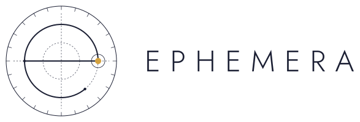

<p align="center">
  <picture>
    <source media="(prefers-color-scheme: dark)" srcset="assets/logo/lockup-horizontal-dark.svg">
    
  </picture>
</p>

**A pocket-sized, MIT-licensed ephemeris for astrology and astronomy.**
JPL-grade planetary positions, houses, ayanamsas, eclipses, fixed stars and
1,000+ asteroids, in a dependency-free C library and a 49 KB WebAssembly core.

[](https://www.npmjs.com/package/@astrologer/ephemera)
[](LICENSE)


```js
import { createEphemera, Body } from '@astrologer/ephemera';

const eph = await createEphemera();       // planetary data built in
const jd = eph.julianDate(2026, 1, 1.5);  // 1 Jan 2026, 12:00 UT
eph.position(Body.Moon, jd);              // { longitude: 74.23, latitude: 5.05, longitudeSpeed: 15.04, … }
```

## Why Ephemera

- **Tiny.** A 49 KB WebAssembly core, plus 145 KB of data for all the
  planets to ~0.5″. Swiss Ephemeris needs about 2 MB of data files for full
  precision over 600 years.
- **Accurate.** Within 0.03″ of NASA JPL's DE440 over 1550–2650 with the
  high-precision tables, and within 0.6″ with the smallest data file.
- **MIT licensed.** Use it in closed-source and commercial apps, with no
  AGPL obligations and no licence fee.
- **Runs anywhere.** C and C++, Python, WebAssembly, Node and browsers,
  from one codebase with no dependencies and no runtime imports.
- **Complete for astrology.** 14 house systems, 42 ayanamsas, nodes and
  Lilith, Uranian points, fixed stars, eclipses, returns, stations and
  1,000+ asteroids.
- **Independently verified.** Every feature is tested against JPL, NASA's
  eclipse canon, India's official ephemeris or an independent
  implementation. See [accuracy](docs/accuracy.md).

## Compared with Swiss Ephemeris

|  | Ephemera | Swiss Ephemeris |
|---|---|---|
| Licence | **MIT** | AGPL or paid commercial licence |
| WebAssembly core | **118 KB (49 KB brotli)** | 425 KB (174 KB brotli), `@swisseph/browser` |
| Data for ~0.5″ planets and Moon | **145 KB, 1550–2650** | Moshier mode needs no files, but is up to 3.2″ off for the Moon and 2.5″ for Pluto (1850–2140) |
| High-precision data | 0.03″ max, 0.002″ median: 3.7 MB for 1550–2650 | about 2 MB per 600 years (1800–2400) |
| Date range at full accuracy | 1550–2650 | **13,000 BC – AD 17,000** |
| House systems | 14 | **~25** |
| Asteroids | 1,083 pre-built (1900–2100) | **any numbered asteroid** from its own files |
| Verification | tested against JPL, NASA and IAE in this repository | long track record in astrology software |

Swiss Ephemeris remains the reference for ancient and far-future dates.
Ephemera covers what modern astrology apps need, at a fraction of the size.

## Quick start

**JavaScript or TypeScript** (Node 18+, browsers, bundlers):

```sh
npm install @astrologer/ephemera
```

```js
import { createEphemera, Body, HouseSystem, Ayanamsa } from '@astrologer/ephemera';

const eph = await createEphemera();
const jd = eph.julianDate(2026, 1, 1.5);                              // UT
const sun = eph.position(Body.Sun, jd);                               // degrees, AU, per day
const cusps = eph.houses(jd, -0.1278, 51.5074, HouseSystem.Placidus); // London
const lahiri = eph.ayanamsa(Ayanamsa.Lahiri, eph.utToTt(jd, 2026));  // sidereal = tropical − ayanamsa
const eclipse = eph.solarEclipse(eph.utToTt(jd, 2026));               // the next solar eclipse
```

**Python** (3.9+; wheels for Linux, macOS and Windows):

```sh
pip install pyephemera
```

```python
import ephemera as eph

jd = eph.julian_date(2026, 1, 1.5)                                    # UT
moon = eph.position(eph.Body.MOON, jd)                                # degrees, AU, per day
cusps = eph.houses(jd, -0.1278, 51.5074, eph.HouseSystem.PLACIDUS)    # London
```

**C** (any C or C++ compiler; build with CMake or `make`):

```c
#include "ephemeris/ephemeris.h"

eph_load_file("data/eph-1as.bin");                    /* once, at start-up */
double jd = eph_julian_date(2026, 1, 1.5);            /* UT */
eph_position moon;
eph_position_apparent_ut(EPH_MOON, jd, 2026.0, &moon); /* radians, AU, per day */
```

## Features

| Positions | Astrology | Astronomy | Time |
|---|---|---|---|
| ✅ Sun, Moon, planets, Pluto | ✅ 14 house systems | ✅ Solar eclipses, global and local | ✅ UTC with leap seconds, ΔT |
| ✅ Geocentric, topocentric, heliocentric | ✅ Vertex, co-ascendants, polar ascendant | ✅ Lunar eclipses with saros | ✅ Sidereal time (IAU 2006) |
| ✅ Ceres, Pallas, Juno, Vesta, Chiron | ✅ 42 ayanamsas and custom ones | ✅ Phase, elongation, magnitude | ✅ Equation of time |
| ✅ 1,083 more asteroids, centaurs, TNOs | ✅ Mean and true node, Lilith | ✅ 411 named fixed stars | ✅ Nutation, obliquity |
| ✅ Speeds, retrograde motion | ✅ Uranian points (Hamburg School) | ✅ Planetary nodes and apsides | ✅ Ecliptic ↔ equatorial |
| ✅ Apparent places (light-time, aberration) | ✅ Returns, ingresses, stations, sidereal returns | ✅ Planetary orbits, mean and osculating | ✅ Midpoints, sign/degree split |

All features are covered in the [guide](docs/guide.md).

## Pick your data

Load one planetary file; everything else is optional.

| File | Size | Accuracy | Covers |
|---|---|---|---|
| `eph-1as.bin` (built into the npm default) | 145 KB | ~0.5″ | planets, Sun, Moon, Pluto, 1550–2650 |
| `eph-01as.bin` | 303 KB | ~0.2″ | the same |
| `eph-full.bin` | 649 KB | ~0.15″ | the same |
| `de440/de440-YEAR.bin` | ~330 KB per century | 0.03″ (0.002″ median) | the same, per century |
| `eph-chiron.bin`, `eph-asteroids.bin` | 60 KB, 425 KB | 0.02″ | Chiron; Ceres to Vesta and Chiron, 1600–2500 |
| `eph-stars.bin` | 26 KB | 0.015″ | 411 named stars |
| `eph-minor.bin`, `eph-minor-1000.bin` | 5.7 MB, 17 MB | 0.25″ | 180 popular minor planets; numbered 1–1000, 1900–2100 |

Details are in [data files](docs/data.md).

## Build

```sh
make -j && make test            # or: cmake -S . -B build && cmake --build build && ctest --test-dir build
make wasm && make npm           # WebAssembly modules and the npm package (needs zig and node)
make python-test                # the Python package: builds a wheel and tests it
```

## Documentation

- [Guide](docs/guide.md): building, the C and JS APIs, and every feature.
- [Accuracy](docs/accuracy.md): what each feature is tested against, and
  the full error tables.
- [Data files](docs/data.md): contents, formats and how to regenerate them.
- [Methods](docs/methods.md): theories, references and data sources.

## License

MIT, see [LICENSE](LICENSE). Use it anywhere, open or closed source,
commercial or not; keep the copyright notice. The library is built from
public data: JPL DE440 and Horizons, NASA's eclipse catalogues, VSOP87 and
ELP2000-82B, and Hipparcos. Details are in [methods](docs/methods.md#data-sources).
No third-party code is included.
